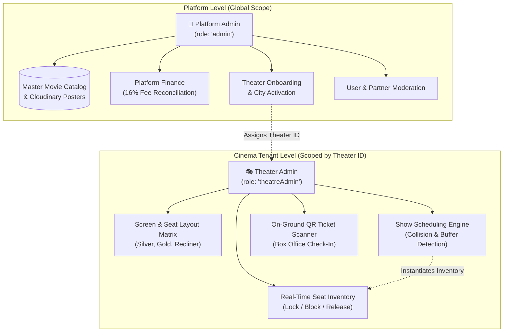
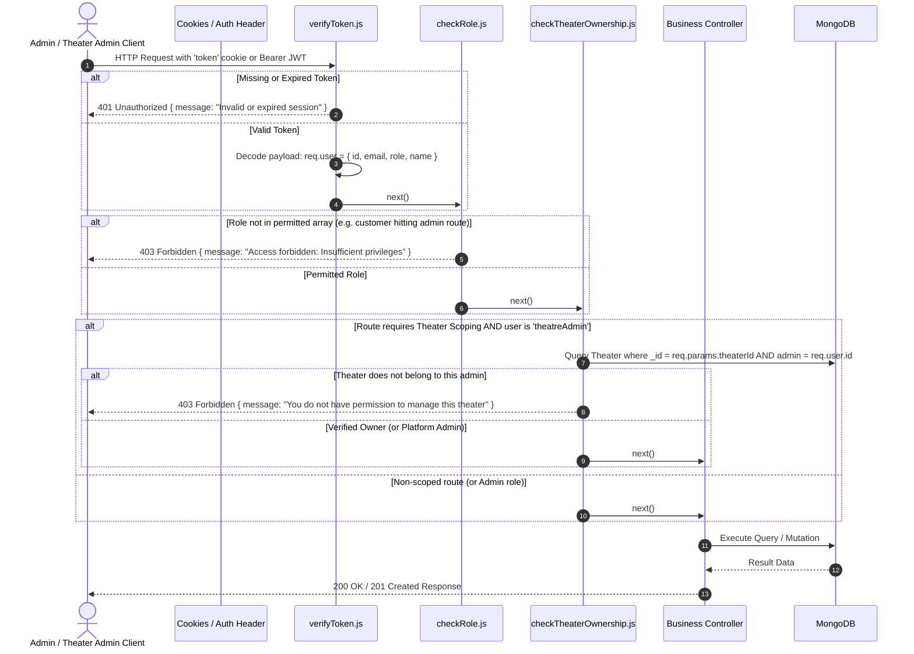
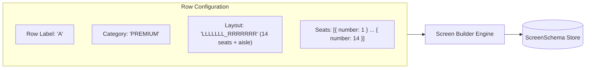
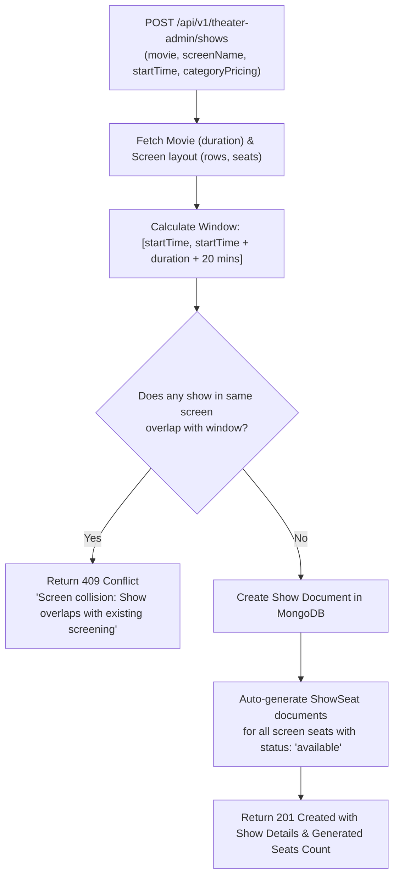
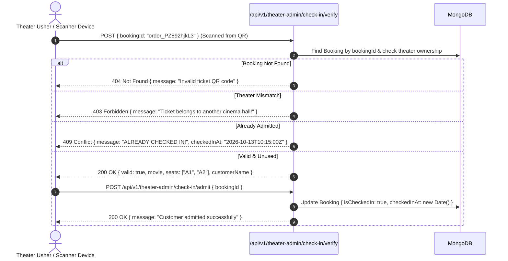
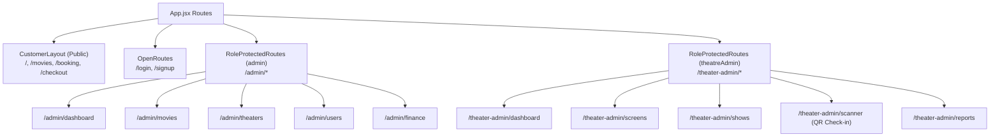

# 👑 CineVerse - Admin & Theater Admin Features and API Endpoints Specification

A comprehensive technical and functional specification for **Platform Admin (Super Admin)** and **Theater Admin (Cinema Partner / Theatre Manager)** roles within CineVerse.

---

## 📑 Table of Contents
1. [Executive Summary & Role Architecture](#1-executive-summary--role-architecture)
2. [Role-Based Access Control (RBAC) & Security Flow](#2-role-based-access-control-rbac--security-flow)
   - [Role Permission Matrix](#role-permission-matrix)
   - [Authentication & Authorization Pipeline](#authentication--authorization-pipeline)
3. [Database Schema Enhancements](#3-database-schema-enhancements)
4. [Platform Admin (Super Admin) Features & API Endpoints](#4-platform-admin-super-admin-features--api-endpoints)
   - [4.1 Platform Analytics & KPI Dashboard](#41-platform-analytics--kpi-dashboard)
   - [4.2 User & Identity Governance](#42-user--identity-governance)
   - [4.3 Global Movie Catalog Management](#43-global-movie-catalog-management)
   - [4.4 Theater Partner Onboarding & Governance](#44-theater-partner-onboarding--governance)
   - [4.5 Operational Cities & Geofencing](#45-operational-cities--geofencing)
   - [4.6 Platform Finance & Revenue Settlement](#46-platform-finance--revenue-settlement)
   - [4.7 Coupon & Discount Code Management](#47-coupon--discount-code-management)
5. [Theater Admin (Theatre Manager) Features & API Endpoints](#5-theater-admin-theatre-manager-features--api-endpoints)
   - [5.1 Theater Dashboard & Live Operations](#51-theater-dashboard--live-operations)
   - [5.2 Theater Profile & Amenities Setup](#52-theater-profile--amenities-setup)
   - [5.3 Screen Layout Matrix & Category Builder](#53-screen-layout-matrix--category-builder)
   - [5.4 Showtime Scheduling & Conflict-Prevention Engine](#54-showtime-scheduling--conflict-prevention-engine)
   - [5.5 Category Pricing & Dynamic Show Pricing](#55-category-pricing--dynamic-show-pricing)
   - [5.6 Real-Time Seat Inventory & Maintenance Blocking](#56-real-time-seat-inventory--maintenance-blocking)
   - [5.7 Box Office & QR Ticket Verification Scanner](#57-box-office--qr-ticket-verification-scanner)
   - [5.8 Theater Sales, Occupancy & Settlement Ledger](#58-theater-sales-occupancy--settlement-ledger)
6. [Middleware Implementation Reference](#6-middleware-implementation-reference)
   - [checkRole Middleware](#checkrole-middleware)
   - [checkTheaterOwnership Middleware](#checktheaterownership-middleware)
7. [Frontend Routing & UI Integration](#7-frontend-routing--ui-integration)
8. [Consolidated API Endpoint Registry](#8-consolidated-api-endpoint-registry)

---

## 1. Executive Summary & Role Architecture

CineVerse operates on a multi-tenant cinema architecture with three distinct user roles defined in [userModel.js](file:///d:/cineVerse/server/models/userModel.js):

| Role Identifier in DB | Display Role Name | Architectural Scope | Primary Responsibilities |
|---|---|---|---|
| `'admin'` | **Platform Admin** (Super Admin) | **Global / Platform-wide** | Master catalog, partner onboarding, financial commissions, system health, platform user moderation. |
| `'theatreAdmin'` | **Theater Admin** (Cinema Partner) | **Tenant-specific** (Scoped to assigned Theaters) | Screen matrices, showtime schedules, dynamic seat pricing, maintenance seat blocks, on-ground QR ticket check-ins, theater occupancy reports. |
| `'customer'` | **Customer** (End User) | **User-specific** | Discovery, seat selection, booking, Razorpay checkout, e-ticket viewing. |



---

## 2. Role-Based Access Control (RBAC) & Security Flow

### Role Permission Matrix

| Capability / Resource | Platform Admin (`admin`) | Theater Admin (`theatreAdmin`) | Customer (`customer`) |
|---|:---:|:---:|:---:|
| View Global Analytics (Platform GMV, All Cities) | ✅ Full | ❌ No | ❌ No |
| View Theater Specific Revenue & Occupancy | ✅ Full | ✅ Scoped to assigned Theater | ❌ No |
| Create / Edit Master Movies (Cloudinary upload) | ✅ Full | ❌ Read Only | ❌ Read Only |
| Register New Theater & Geolocation | ✅ Full | ❌ No | ❌ No |
| Update Assigned Theater Amenities & Phone | ✅ Full | ✅ Scoped to assigned Theater | ❌ No |
| Create / Edit Screen Seating Matrices | ✅ Full | ✅ Scoped to assigned Theater | ❌ No |
| Schedule Showtimes & Set Ticket Pricing | ✅ Full | ✅ Scoped to assigned Theater | ❌ No |
| Maintenance Block / Unblock Individual Seats | ✅ Full | ✅ Scoped to assigned Theater | ❌ No |
| Verify & Scan QR Codes at Gate (Check-In) | ✅ Full | ✅ Scoped to assigned Theater | ❌ No |
| Manage User Accounts & Role Upgrades | ✅ Full | ❌ No | ❌ No |
| Create Promotional Coupons & Site Banners | ✅ Full | ❌ No | ❌ No |
| Book Seats via Payment Gateway | ✅ Allowed | ✅ Allowed | ✅ Core Flow |

---

### Authentication & Authorization Pipeline

Every administrative request passes through a multi-tiered security pipeline:



---

## 3. Database Schema Enhancements

To fully enable theater-admin tenancy and box-office operations, the following fields complement the existing models:

### 1. [theaterModel.js](file:///d:/cineVerse/server/models/theaterModel.js)
```javascript
const theaterSchema = new mongoose.Schema({
  name: { type: String, required: true },
  city: { type: String, required: true },
  location: {
    type: { type: String, default: 'Point' },
    coordinates: { type: [Number], required: true }, // [longitude, latitude]
  },
  // Tenant Reference
  admin: { 
    type: mongoose.Schema.Types.ObjectId, 
    ref: 'User',
    required: true 
  },
  facilities: [{ type: String }], // e.g. ['Dolby Atmos', '4K Laser', 'Recliner', 'Parking', 'Food Court']
  address: { type: String, required: true },
  contactPhone: { type: String },
  isActive: { type: Boolean, default: true }
}, { timestamps: true });
```

### 2. [showSeatModel.js](file:///d:/cineVerse/server/models/showSeatModel.js)
```javascript
const showSeatSchema = new mongoose.Schema({
  show: { type: mongoose.Schema.Types.ObjectId, ref: 'Show', required: true },
  seatId: { type: String, required: true },
  status: { 
    type: String, 
    enum: ['available', 'locked', 'booked', 'blocked'], // 'blocked' for maintenance/VIP
    default: 'available' 
  },
  lockedBy: { type: String },
  lockedExpiresAt: Date,
  blockReason: { type: String }, // e.g. 'Broken Armrest', 'VIP Hold', 'Box Office Offline'
  price: Number,
});
```

### 3. [bookingModel.js](file:///d:/cineVerse/server/models/bookingModel.js)
```javascript
// Adding check-in state for on-ground ticket verification
bookingSchema.add({
  isCheckedIn: { type: Boolean, default: false },
  checkedInAt: { type: Date },
  checkedInBy: { type: mongoose.Schema.Types.ObjectId, ref: 'User' }
});
```

---

## 4. Platform Admin (Super Admin) Features & API Endpoints

All Platform Admin routes require:
- **Middleware**: `verifyToken`, `checkRole(['admin'])`
- **Base Route Prefix**: `/api/v1/admin`

---

### 4.1 Platform Analytics & KPI Dashboard

#### `GET /api/v1/admin/dashboard/metrics`
Retrieves consolidated platform health and commercial numbers across all cities and theaters.

- **Query Parameters**:
  - `startDate` (optional, ISO date, e.g., `2026-10-01`)
  - `endDate` (optional, ISO date, e.g., `2026-10-13`)
- **Success Response (`200 OK`)**:
  ```json
  {
    "success": true,
    "data": {
      "totalGrossRevenue": 14258900,
      "totalPlatformConvenienceFees": 2281424,
      "totalTicketsSold": 48200,
      "totalTheaters": 18,
      "activeTheaters": 16,
      "totalMoviesPlaying": 12,
      "totalRegisteredUsers": 35400,
      "todayBookingsCount": 1420,
      "todayRevenue": 485000
    }
  }
  ```

#### `GET /api/v1/admin/dashboard/revenue-analytics`
Provides time-series revenue and ticket volume for charts.

- **Query Parameters**:
  - `interval` (`daily` | `weekly` | `monthly`, default: `daily`)
  - `limit` (number of records, default: `30`)
- **Success Response (`200 OK`)**:
  ```json
  {
    "success": true,
    "data": [
      {
        "date": "2026-10-12",
        "grossRevenue": 384500,
        "platformFee": 61520,
        "ticketsCount": 1290,
        "bookingCount": 460
      }
    ]
  }
  ```

#### `GET /api/v1/admin/dashboard/top-performing`
Ranks movies, theaters, and cities by total gross collection and occupancy.

- **Success Response (`200 OK`)**:
  ```json
  {
    "success": true,
    "data": {
      "topMovies": [
        { "movieId": "670...", "title": "Pushpa 2: The Rule", "ticketsSold": 18200, "revenue": 5460000 },
        { "movieId": "671...", "title": "Stree 2", "ticketsSold": 14100, "revenue": 3948000 }
      ],
      "topTheaters": [
        { "theaterId": "66f...", "name": "PVR Inox GT Central", "city": "Jaipur", "occupancyRate": 84.5, "revenue": 2180000 }
      ],
      "topCities": [
        { "city": "Jaipur", "revenue": 4520000, "tickets": 15400 }
      ]
    }
  }
  ```

---

### 4.2 User & Identity Governance

#### `GET /api/v1/admin/users`
Paginated search and filter for all users on the platform.

- **Query Parameters**:
  - `search` (name, email, mobileNo)
  - `role` (`customer` | `theatreAdmin` | `admin`)
  - `isActive` (`true` | `false`)
  - `page` (default: 1), `limit` (default: 20)
- **Success Response (`200 OK`)**:
  ```json
  {
    "success": true,
    "count": 20,
    "total": 35400,
    "totalPages": 1770,
    "page": 1,
    "data": [
      {
        "_id": "670c...",
        "name": "Vikram Rathore",
        "email": "vikram@pvr.com",
        "mobileNo": "9829012345",
        "role": "theatreAdmin",
        "isActive": true,
        "isVerified": true,
        "createdAt": "2026-09-15T10:00:00.000Z"
      }
    ]
  }
  ```

#### `PATCH /api/v1/admin/users/:userId/role`
Promote or demote user roles (e.g. promoting a customer to a `theatreAdmin`).

- **Path Parameter**: `userId`
- **Request Body**:
  ```json
  {
    "role": "theatreAdmin"
  }
  ```
- **Validation**: Role must be one of `['customer', 'theatreAdmin', 'admin']`.
- **Success Response (`200 OK`)**:
  ```json
  {
    "success": true,
    "message": "User role updated successfully",
    "data": {
      "_id": "670c...",
      "name": "Vikram Rathore",
      "role": "theatreAdmin"
    }
  }
  ```

#### `PATCH /api/v1/admin/users/:userId/status`
Suspend or un-suspend a user account.

- **Request Body**:
  ```json
  {
    "isActive": false,
    "reason": "Suspicious automated booking pattern"
  }
  ```
- **Success Response (`200 OK`)**:
  ```json
  {
    "success": true,
    "message": "User account status updated to inactive"
  }
  ```

---

### 4.3 Global Movie Catalog Management

#### `POST /api/v1/admin/movies`
Add a new movie to the master platform catalog. Automatically uploads the poster stream to Cloudinary CDN.

- **Content-Type**: `multipart/form-data`
- **Form Fields**:
  - `title` (string, required)
  - `duration` (number in minutes, required, e.g. `165`)
  - `genres` (array or comma-delimited strings: `["Action", "Thriller"]`)
  - `censorRating` (string: `U`, `UA`, `A`)
  - `releaseDate` (date: `2026-11-05`)
  - `description` (string)
  - `poster` (Binary file, required, max 5MB, JPG/PNG/WebP)
- **Controller Action**: Uploads `req.file.buffer` to Cloudinary via `cloudinary.uploader.upload_stream` and saves `secure_url`.
- **Success Response (`201 Created`)**:
  ```json
  {
    "success": true,
    "message": "Movie successfully published to master catalog",
    "data": {
      "_id": "670e...",
      "title": "Singham Again",
      "poster": "https://res.cloudinary.com/cineverse/image/upload/v1728.../singham.jpg",
      "duration": 154,
      "genres": ["Action", "Drama"],
      "censorRating": "UA",
      "releaseDate": "2026-11-01T00:00:00.000Z",
      "isActive": true
    }
  }
  ```

#### `PUT /api/v1/admin/movies/:id`
Updates existing movie details or replaces poster image.

- **Request Body / Form-Data**: Partial or full fields (`title`, `duration`, `genres`, `poster`, `isActive`).
- **Success Response (`200 OK`)**:
  ```json
  {
    "success": true,
    "message": "Movie updated successfully",
    "data": { ... }
  }
  ```

#### `PATCH /api/v1/admin/movies/:id/toggle-status`
Toggle movie active status (`isActive`). Inactive movies cannot have new shows scheduled.

- **Success Response (`200 OK`)**:
  ```json
  {
    "success": true,
    "message": "Movie status updated",
    "isActive": false
  }
  ```

---

### 4.4 Theater Partner Onboarding & Governance

#### `POST /api/v1/admin/theaters`
Onboards a new cinema property into CineVerse and assigns a theater administrator.

- **Request Body**:
  ```json
  {
    "name": "Cinepolis World Trade Park",
    "city": "Jaipur",
    "adminId": "670c...",
    "location": {
      "type": "Point",
      "coordinates": [75.8055, 26.8532]
    },
    "address": "Jawahar Lal Nehru Marg, D-Block, Malviya Nagar, Jaipur, Rajasthan 302017",
    "contactPhone": "+91 141 2728900",
    "facilities": ["Dolby Atmos", "4K Projection", "Food Court", "Parking", "Recliner"]
  }
  ```
- **Validation**:
  - `adminId` must exist in `User` collection and possess `theatreAdmin` or `admin` role.
  - `coordinates` must be `[longitude, latitude]` for MongoDB `2dsphere` spatial indexing.
- **Success Response (`201 Created`)**:
  ```json
  {
    "success": true,
    "message": "Theater property onboarded successfully",
    "data": {
      "_id": "670f1a...",
      "name": "Cinepolis World Trade Park",
      "city": "Jaipur",
      "admin": "670c...",
      "location": {
        "type": "Point",
        "coordinates": [75.8055, 26.8532]
      },
      "isActive": true
    }
  }
  ```

#### `GET /api/v1/admin/theaters`
List all onboarded theaters with their assigned admin, screen counts, and coordinates.

- **Query Parameters**:
  - `city` (filter by city name)
  - `status` (`active` | `inactive`)
  - `search` (filter by theater name)
- **Success Response (`200 OK`)**:
  ```json
  {
    "success": true,
    "count": 18,
    "data": [
      {
        "_id": "670f1a...",
        "name": "Cinepolis World Trade Park",
        "city": "Jaipur",
        "admin": {
          "_id": "670c...",
          "name": "Vikram Rathore",
          "email": "vikram@cinepolis.com"
        },
        "screensCount": 4,
        "isActive": true
      }
    ]
  }
  ```

#### `PATCH /api/v1/admin/theaters/:id/assign-admin`
Reassigns theater management rights to another theater administrator.

- **Request Body**:
  ```json
  {
    "newAdminId": "670d99..."
  }
  ```
- **Success Response (`200 OK`)**:
  ```json
  {
    "success": true,
    "message": "Theater administrator successfully updated"
  }
  ```

---

### 4.5 Operational Cities & Geofencing

#### `POST /api/v1/admin/cities`
Add an authorized city for geolocation discovery.

- **Request Body**:
  ```json
  {
    "name": "Jaipur",
    "state": "Rajasthan",
    "coordinates": [75.7873, 26.9124],
    "isActive": true
  }
  ```
- **Success Response (`201 Created`)**:
  ```json
  {
    "success": true,
    "message": "City added to operational zones"
  }
  ```

#### `GET /api/v1/admin/cities`
Fetches all operational cities with theater metrics.

- **Success Response (`200 OK`)**:
  ```json
  {
    "success": true,
    "data": [
      { "_id": "66e...", "name": "Jaipur", "theatersCount": 6, "isActive": true },
      { "_id": "66f...", "name": "Mumbai", "theatersCount": 12, "isActive": true }
    ]
  }
  ```

---

### 4.6 Platform Finance & Revenue Settlement

#### `GET /api/v1/admin/finance/transactions`
Master ledger of all customer payments and Razorpay settlement traces.

- **Query Parameters**:
  - `status` (`success` | `failed`)
  - `theaterId`
  - `startDate`, `endDate`
  - `page`, `limit`
- **Success Response (`200 OK`)**:
  ```json
  {
    "success": true,
    "count": 50,
    "data": [
      {
        "bookingId": "order_PZ892hjkL3",
        "user": { "name": "Ritesh Patidar", "email": "ritesh@example.com" },
        "theater": { "name": "PVR Inox GT Central" },
        "movie": { "title": "Pushpa 2: The Rule" },
        "ticketsCount": 2,
        "seatsTotal": 500,
        "convenienceFee": 80,
        "totalAmount": 580,
        "razorPayPaymentId": "pay_PZ8992kllA",
        "createdAt": "2026-10-12T14:30:00.000Z"
      }
    ]
  }
  ```

#### `GET /api/v1/admin/finance/settlements`
Computes the partner theater payout ledger:
- **Formula**: `Theater Payout = Gross Seats Total - Platform Withholding Fee`

- **Success Response (`200 OK`)**:
  ```json
  {
    "success": true,
    "data": [
      {
        "theaterId": "66f...",
        "theaterName": "PVR Inox GT Central",
        "totalGrossSales": 450000,
        "platformCommission": 72000,
        "netPayableToTheater": 378000,
        "settlementStatus": "pending",
        "cycle": "2026-10-01 to 2026-10-15"
      }
    ]
  }
  ```

#### `POST /api/v1/admin/finance/settlements/:theaterId/mark-paid`
Marks payout disbursed to the cinema partner with reference transaction ID.

- **Request Body**:
  ```json
  {
    "settlementCycle": "2026-10-01_to_2026-10-15",
    "amountPaid": 378000,
    "paymentReference": "NEFT_CMS_992182019"
  }
  ```
- **Success Response (`200 OK`)**:
  ```json
  {
    "success": true,
    "message": "Settlement payment marked as disbursed"
  }
  ```

---

### 4.7 Coupon & Discount Code Management

#### `POST /api/v1/admin/coupons`
Creates promotional discount codes for platform campaigns.

- **Request Body**:
  ```json
  {
    "code": "CINEVERSE50",
    "discountType": "percentage",
    "discountValue": 50,
    "maxDiscountAmount": 150,
    "minimumOrderAmount": 300,
    "validUntil": "2026-12-31T23:59:59.000Z",
    "usageLimit": 10000
  }
  ```
- **Success Response (`201 Created`)**:
  ```json
  {
    "success": true,
    "message": "Coupon code created successfully"
  }
  ```

---

## 5. Theater Admin (Theatre Manager) Features & API Endpoints

All Theater Admin routes require:
- **Middleware**: `verifyToken`, `checkRole(['theatreAdmin', 'admin'])`, `checkTheaterOwnership`
- **Base Route Prefix**: `/api/v1/theater-admin`

---

### 5.1 Theater Dashboard & Live Operations

#### `GET /api/v1/theater-admin/dashboard/summary`
Live operations snapshot for the manager's assigned theater property.

- **Headers / Query**: `?theaterId=66f...` (or auto-detected from assigned profile)
- **Success Response (`200 OK`)**:
  ```json
  {
    "success": true,
    "data": {
      "theaterName": "PVR Inox GT Central",
      "todayShowsCount": 16,
      "todayBookingsCount": 420,
      "todayTicketsSold": 1150,
      "todayGrossRevenue": 287500,
      "currentOccupancyRate": 76.4,
      "activeScreensCount": 3
    }
  }
  ```

#### `GET /api/v1/theater-admin/dashboard/today-schedule`
Lists all shows running today across screens with live capacity statistics.

- **Success Response (`200 OK`)**:
  ```json
  {
    "success": true,
    "data": [
      {
        "showId": "6abddb2b11b0b22d820e6ec4",
        "movieTitle": "Pushpa 2: The Rule",
        "screenName": "Screen 1 - Dolby Atmos",
        "startTime": "2026-10-13T10:30:00.000Z",
        "totalSeats": 180,
        "bookedSeats": 145,
        "lockedSeats": 10,
        "availableSeats": 25,
        "occupancyPercentage": 80.5
      }
    ]
  }
  ```

---

### 5.2 Theater Profile & Amenities Setup

#### `GET /api/v1/theater-admin/profile`
Fetches configuration and facilities for the authenticated partner's cinema.

- **Success Response (`200 OK`)**:
  ```json
  {
    "success": true,
    "data": {
      "_id": "66f...",
      "name": "PVR Inox GT Central",
      "city": "Jaipur",
      "address": "4th Floor, GT Central Mall, Malviya Nagar, Jaipur",
      "contactPhone": "+91 141 4001234",
      "facilities": ["Dolby Atmos", "4K Laser", "Recliner Seating", "Food Court"],
      "isActive": true
    }
  }
  ```

#### `PUT /api/v1/theater-admin/profile`
Updates theater amenity tags, customer care phone, and location address.

- **Request Body**:
  ```json
  {
    "contactPhone": "+91 141 4005678",
    "facilities": ["Dolby Atmos", "4K Laser", "Recliner Seating", "Food Court", "Wheelchair Accessible", "Valet Parking"]
  }
  ```
- **Success Response (`200 OK`)**:
  ```json
  {
    "success": true,
    "message": "Theater amenities and contact details updated"
  }
  ```

---

### 5.3 Screen Layout Matrix & Category Builder

Screens in CineVerse follow a customizable grid layout with row labels, seating categories (`REGULAR`, `PREMIUM`, `RECLINER`), and layout patterns (e.g. `LLLLLL_RRRRRR` with aisle space indicators) defined in [ScreenModel.js](file:///d:/cineVerse/server/models/ScreenModel.js).



#### `POST /api/v1/theater-admin/screens`
Creates a new auditorium / screen configuration.

- **Request Body**:
  ```json
  {
    "theaterId": "66f...",
    "name": "Audi 1 - Dolby 7.1",
    "rows": [
      {
        "label": "A",
        "category": "PREMIUM",
        "layout": "LLLLLLL_RRRRRRR",
        "start": 1,
        "spaceAfter": 7,
        "seats": [
          { "number": 1 }, { "number": 2 }, { "number": 3 }, { "number": 4 },
          { "number": 5 }, { "number": 6 }, { "number": 7 }, { "number": 8 },
          { "number": 9 }, { "number": 10 }, { "number": 11 }, { "number": 12 },
          { "number": 13 }, { "number": 14 }
        ]
      },
      {
        "label": "B",
        "category": "REGULAR",
        "layout": "LLLLLLL_RRRRRRR",
        "start": 1,
        "spaceAfter": 7,
        "seats": [
          { "number": 1 }, { "number": 2 }, { "number": 3 }, { "number": 4 },
          { "number": 5 }, { "number": 6 }, { "number": 7 }, { "number": 8 },
          { "number": 9 }, { "number": 10 }, { "number": 11 }, { "number": 12 },
          { "number": 13 }, { "number": 14 }
        ]
      }
    ]
  }
  ```
- **Success Response (`201 Created`)**:
  ```json
  {
    "success": true,
    "message": "Screen configuration created successfully",
    "data": {
      "_id": "670f9b...",
      "name": "Audi 1 - Dolby 7.1",
      "theater": "66f...",
      "totalSeats": 28
    }
  }
  ```

#### `GET /api/v1/theater-admin/screens`
List all screens configured under the theater property.

- **Success Response (`200 OK`)**:
  ```json
  {
    "success": true,
    "data": [
      {
        "_id": "670f9b...",
        "name": "Audi 1 - Dolby 7.1",
        "rowsCount": 12,
        "totalSeats": 180
      }
    ]
  }
  ```

#### `PUT /api/v1/theater-admin/screens/:screenId`
Updates row arrangement, seating counts, or screen label.

- **Validation Rule**: Cannot modify layout if an upcoming show in this screen has booked seats.
- **Success Response (`200 OK`)**:
  ```json
  {
    "success": true,
    "message": "Screen layout updated successfully"
  }
  ```

#### `DELETE /api/v1/theater-admin/screens/:screenId`
Deactivates or deletes an auditorium.

- **Success Response (`200 OK`)**:
  ```json
  {
    "success": true,
    "message": "Screen successfully decommissioned"
  }
  ```

---

### 5.4 Showtime Scheduling & Conflict-Prevention Engine

When scheduling a show, the theater admin links a movie to a screen at a specific date and time.
The scheduling engine enforces **Auditorium Time Collision Detection**:
- **Show Duration** = `Movie.duration`
- **Cleaning & Interval Buffer** = `20 minutes`
- **Total Occupied Window** = `[startTime, startTime + duration + 20 mins]`

If another show is scheduled in that screen whose window overlaps, the request is rejected with `409 Conflict`.



#### `POST /api/v1/theater-admin/shows`
Schedule a new showtime and automatically populate the screen's seat inventory.

- **Request Body**:
  ```json
  {
    "theaterId": "66f...",
    "movieId": "670e...",
    "screenName": "Audi 1 - Dolby 7.1",
    "showDate": "2026-10-15T00:00:00.000Z",
    "startTime": "2026-10-15T14:30:00.000Z",
    "categoryPricing": [
      { "category": "REGULAR", "price": 200 },
      { "category": "PREMIUM", "price": 320 },
      { "category": "RECLINER", "price": 450 }
    ]
  }
  ```
- **Validation**:
  - `startTime` must be in the future.
  - Overlap check: No existing show on that screen between `[startTime - buffer, startTime + movie.duration + buffer]`.
- **Side Effects**:
  - Automatically queries the `ScreenSchema` rows for `screenName` in that theater.
  - Generates individual [ShowSeat](file:///d:/cineVerse/server/models/showSeatModel.js) documents for all seats (`A1`, `A2`, etc.) with `status: 'available'` and price matching the seat's row category.
- **Success Response (`201 Created`)**:
  ```json
  {
    "success": true,
    "message": "Show scheduled and seat inventory successfully generated",
    "data": {
      "showId": "670fc1...",
      "movieTitle": "Singham Again",
      "screenName": "Audi 1 - Dolby 7.1",
      "startTime": "2026-10-15T14:30:00.000Z",
      "endTimeWithBuffer": "2026-10-15T17:24:00.000Z",
      "totalSeatsGenerated": 180
    }
  }
  ```

#### `GET /api/v1/theater-admin/shows`
List shows scheduled in the theater with date and screen filters.

- **Query Parameters**:
  - `date` (YYYY-MM-DD)
  - `screenName`
  - `movieId`
- **Success Response (`200 OK`)**:
  ```json
  {
    "success": true,
    "count": 4,
    "data": [
      {
        "_id": "670fc1...",
        "movie": { "title": "Singham Again", "poster": "https://..." },
        "screenName": "Audi 1 - Dolby 7.1",
        "startTime": "2026-10-15T14:30:00.000Z",
        "categoryPricing": [
          { "category": "REGULAR", "price": 200 },
          { "category": "PREMIUM", "price": 320 }
        ],
        "bookedSeatsCount": 42
      }
    ]
  }
  ```

#### `DELETE /api/v1/theater-admin/shows/:showId`
Cancels an upcoming show.

- **Business Rule**:
  - If seats have already been booked, triggers notification and cancellation flow.
  - Cascades status update to `ShowSeat` records.
- **Success Response (`200 OK`)**:
  ```json
  {
    "success": true,
    "message": "Show screening successfully cancelled"
  }
  ```

---

### 5.5 Category Pricing & Dynamic Show Pricing

#### `PATCH /api/v1/theater-admin/shows/:showId/pricing`
Updates ticket prices for categories (e.g. discount for morning shows or weekend surge pricing).

- **Request Body**:
  ```json
  {
    "categoryPricing": [
      { "category": "REGULAR", "price": 180 },
      { "category": "PREMIUM", "price": 280 },
      { "category": "RECLINER", "price": 400 }
    ]
  }
  ```
- **Behavior**: Updates base `categoryPricing` on `Show` and bulk updates prices on non-booked `ShowSeat` records.
- **Success Response (`200 OK`)**:
  ```json
  {
    "success": true,
    "message": "Show category pricing updated"
  }
  ```

---

### 5.6 Real-Time Seat Inventory & Maintenance Blocking

Theater managers frequently need to mark seats as **blocked** due to physical seat damage (broken recliner, armrest) or reserved for on-ground VIP delegates.

#### `GET /api/v1/theater-admin/shows/:showId/inventory`
Fetches the interactive grid status for manager inspection (includes booked customer details and block reasons).

- **Success Response (`200 OK`)**:
  ```json
  {
    "success": true,
    "data": {
      "showId": "670fc1...",
      "summary": {
        "available": 130,
        "locked": 4,
        "booked": 42,
        "blocked": 4
      },
      "seats": [
        { "seatId": "A1", "status": "blocked", "blockReason": "Broken recliner motor" },
        { "seatId": "A2", "status": "booked", "customerName": "Ayushman K." },
        { "seatId": "A3", "status": "available" }
      ]
    }
  }
  ```

#### `POST /api/v1/theater-admin/shows/:showId/seats/block`
Locks seats out of the customer booking pool for maintenance or VIP reservation.

- **Request Body**:
  ```json
  {
    "seatIds": ["A1", "A2"],
    "reason": "Broken Recliner Motor - Awaiting Maintenance"
  }
  ```
- **Validation**: Cannot block seats that are already `status === 'booked'`.
- **Success Response (`200 OK`)**:
  ```json
  {
    "success": true,
    "message": "Seats successfully blocked from customer discovery",
    "blockedSeats": ["A1", "A2"]
  }
  ```

#### `POST /api/v1/theater-admin/shows/:showId/seats/unblock`
Restores maintenance/VIP seats back to `'available'`.

- **Request Body**:
  ```json
  {
    "seatIds": ["A1", "A2"]
  }
  ```
- **Success Response (`200 OK`)**:
  ```json
  {
    "success": true,
    "message": "Seats restored to available pool"
  }
  ```

---

### 5.7 Box Office & QR Ticket Verification Scanner

For ticket counter staff and gate ushers scanning CineVerse digital tickets.



#### `POST /api/v1/theater-admin/check-in/verify`
Reads a scanned QR payload or manual Booking ID and returns entry validation.

- **Request Body**:
  ```json
  {
    "bookingId": "order_PZ892hjkL3"
  }
  ```
- **Success Response (`200 OK`)**:
  ```json
  {
    "success": true,
    "valid": true,
    "data": {
      "bookingId": "order_PZ892hjkL3",
      "movieTitle": "Pushpa 2: The Rule",
      "screenName": "Audi 1 - Dolby 7.1",
      "showDate": "2026-10-13",
      "showTime": "14:30",
      "seats": [
        { "seatId": "A1", "row": "A", "number": "1", "category": "PREMIUM" },
        { "seatId": "A2", "row": "A", "number": "2", "category": "PREMIUM" }
      ],
      "totalSeats": 2,
      "customerName": "Ritesh Patidar",
      "paymentStatus": "success",
      "isCheckedIn": false
    }
  }
  ```
- **Error Responses**:
  - `404 Not Found`: `{ "message": "No booking found with this code" }`
  - `403 Forbidden`: `{ "message": "This ticket was booked for a different theater property" }`
  - `409 Conflict`: `{ "message": "TICKET ALREADY USED", "checkedInAt": "2026-10-13T14:10:22.000Z" }`

#### `POST /api/v1/theater-admin/check-in/admit`
Marks the scanned booking as admitted at the gate.

- **Request Body**:
  ```json
  {
    "bookingId": "order_PZ892hjkL3"
  }
  ```
- **Success Response (`200 OK`)**:
  ```json
  {
    "success": true,
    "message": "Patron successfully admitted",
    "admittedSeats": ["A1", "A2"],
    "checkedInAt": "2026-10-13T14:28:10.000Z"
  }
  ```

#### `POST /api/v1/theater-admin/box-office/book`
Allows theater staff to issue offline walk-in tickets directly at the ticket counter.

- **Request Body**:
  ```json
  {
    "showId": "670fc1...",
    "seats": [
      { "seatId": "C4", "price": 200 },
      { "seatId": "C5", "price": 200 }
    ],
    "customerName": "Walk-in Guest",
    "customerMobile": "9829011223",
    "paymentMethod": "CASH" // 'CASH' | 'POS_CARD' | 'UPI_OFFLINE'
  }
  ```
- **Success Response (`201 Created`)**:
  ```json
  {
    "success": true,
    "message": "Box office tickets booked successfully",
    "bookingId": "BOX_OFFICE_9921",
    "receipt": {
      "seats": ["C4", "C5"],
      "totalAmount": 400,
      "convenienceFee": 0
    }
  }
  ```

---

### 5.8 Theater Sales, Occupancy & Settlement Ledger

#### `GET /api/v1/theater-admin/bookings`
Searchable, filterable booking list for this cinema property.

- **Query Parameters**:
  - `showId`
  - `movieId`
  - `date`
  - `search` (customer mobile or booking ID)
  - `page`, `limit`
- **Success Response (`200 OK`)**:
  ```json
  {
    "success": true,
    "count": 20,
    "total": 310,
    "data": [
      {
        "_id": "670fd...",
        "bookingId": "order_PZ892hjkL3",
        "movie": { "title": "Pushpa 2: The Rule" },
        "screenName": "Audi 1 - Dolby 7.1",
        "seats": ["A1", "A2"],
        "pricing": { "seatsTotal": 500, "totalAmount": 580 },
        "isCheckedIn": true,
        "createdAt": "2026-10-12T14:30:00.000Z"
      }
    ]
  }
  ```

#### `GET /api/v1/theater-admin/reports/occupancy`
Auditorium occupancy breakdown by screening and time slot.

- **Query Parameters**: `startDate`, `endDate`
- **Success Response (`200 OK`)**:
  ```json
  {
    "success": true,
    "data": {
      "overallOccupancy": 74.8,
      "screensBreakdown": [
        { "screenName": "Audi 1 - Dolby 7.1", "totalShows": 24, "averageOccupancy": 82.1 },
        { "screenName": "Audi 2 - Standard", "totalShows": 20, "averageOccupancy": 67.5 }
      ],
      "peakHourSlot": "18:00 - 21:00"
    }
  }
  ```

#### `GET /api/v1/theater-admin/reports/payouts`
Partner settlement report detailing ticket revenue and platform fee deductions.

- **Success Response (`200 OK`)**:
  ```json
  {
    "success": true,
    "data": {
      "currentPeriod": "October 2026",
      "grossTicketCollection": 640000,
      "platformFeeWithheld": 102400,
      "netPartnerDisbursement": 537600,
      "disbursementsHistory": [
        { "cycle": "September 2026", "amount": 489000, "status": "settled", "paidOn": "2026-10-02" }
      ]
    }
  }
  ```

---

## 6. Middleware Implementation Reference

The following production-ready middlewares enforce authorization and theater tenancy:

### checkRole Middleware
File: [server/middlewares/checkRole.js](file:///d:/cineVerse/server/middlewares/checkRole.js)

```javascript
/**
 * Middleware to restrict access based on user role.
 * Must be preceded by verifyToken.
 * @param {Array<string>} roles - e.g. ['admin'] or ['theatreAdmin', 'admin']
 */
const checkRole = (roles = []) => {
  return (req, res, next) => {
    if (!req.user || !req.user.role) {
      return res.status(401).json({
        success: false,
        message: 'Authentication required: User session not found',
      });
    }

    if (!roles.includes(req.user.role)) {
      return res.status(403).json({
        success: false,
        message: `Access denied: Role '${req.user.role}' is not authorized to access this resource`,
      });
    }

    next();
  };
};

module.exports = checkRole;
```

---

### checkTheaterOwnership Middleware
File: `server/middlewares/checkTheaterOwnership.js`

```javascript
const Theater = require('../models/theaterModel.js');

/**
 * Middleware ensuring a 'theatreAdmin' only manages their assigned theater property.
 * Platform Admin ('admin') automatically bypasses ownership verification.
 */
const checkTheaterOwnership = async (req, res, next) => {
  try {
    // Platform Super Admin bypasses theater ownership check
    if (req.user && req.user.role === 'admin') {
      return next();
    }

    const theaterId = req.params.theaterId || req.body.theaterId || req.query.theaterId;

    if (!theaterId) {
      // If no theaterId passed in query/param, lookup theater by admin field
      const managedTheater = await Theater.findOne({ admin: req.user.id });
      if (!managedTheater) {
        return res.status(403).json({
          success: false,
          message: 'No theater properties are assigned to your administrator account',
        });
      }
      req.managedTheaterId = managedTheater._id;
      return next();
    }

    const theater = await Theater.findById(theaterId);
    if (!theater) {
      return res.status(404).json({
        success: false,
        message: 'Theater property not found',
      });
    }

    if (theater.admin.toString() !== req.user.id.toString()) {
      return res.status(403).json({
        success: false,
        message: 'Access forbidden: You do not have permission to manage this theater',
      });
    }

    req.theater = theater;
    next();
  } catch (error) {
    return res.status(500).json({
      success: false,
      message: error.message,
    });
  }
};

module.exports = checkTheaterOwnership;
```

---

## 7. Frontend Routing & UI Integration

The React frontend under [client/src/App.jsx](file:///d:/cineVerse/client/src/App.jsx) organizes protected routes using role-aware layout guards:



### Recommended Client Route Structure in [App.jsx](file:///d:/cineVerse/client/src/App.jsx)
```jsx
{/* Platform Admin Console */}
<Route element={<RoleRoute allowedRoles={['admin']} />}>
  <Route element={<AdminLayout />}>
    <Route path="/admin/dashboard" element={<AdminDashboard />} />
    <Route path="/admin/movies" element={<AdminMoviesPage />} />
    <Route path="/admin/theaters" element={<AdminTheatersPage />} />
    <Route path="/admin/users" element={<AdminUsersPage />} />
    <Route path="/admin/finance" element={<AdminFinancePage />} />
  </Route>
</Route>

{/* Theater Partner Console */}
<Route element={<RoleRoute allowedRoles={['theatreAdmin', 'admin']} />}>
  <Route element={<TheaterAdminLayout />}>
    <Route path="/theater-admin/dashboard" element={<TheaterDashboard />} />
    <Route path="/theater-admin/screens" element={<ScreenManagerPage />} />
    <Route path="/theater-admin/shows" element={<ShowSchedulerPage />} />
    <Route path="/theater-admin/scanner" element={<TicketScannerPage />} />
    <Route path="/theater-admin/reports" element={<OccupancyReportsPage />} />
  </Route>
</Route>
```

---

## 8. Consolidated API Endpoint Registry

### Platform Admin APIs (`/api/v1/admin`)

| HTTP Method | Route Endpoint | Purpose / Functionality | Middleware Stack | Key Payload / Query |
|---|---|---|---|---|
| `GET` | `/api/v1/admin/dashboard/metrics` | High-level platform KPIs | `verifyToken`, `checkRole(['admin'])` | `?startDate=&endDate=` |
| `GET` | `/api/v1/admin/dashboard/revenue-analytics` | Revenue time-series charts | `verifyToken`, `checkRole(['admin'])` | `?interval=daily&limit=30` |
| `GET` | `/api/v1/admin/dashboard/top-performing` | Top movies, theaters & cities | `verifyToken`, `checkRole(['admin'])` | None |
| `GET` | `/api/v1/admin/users` | List users with role filter | `verifyToken`, `checkRole(['admin'])` | `?role=&search=&page=&limit=` |
| `PATCH` | `/api/v1/admin/users/:userId/role` | Promote/demote user role | `verifyToken`, `checkRole(['admin'])` | `{ role: 'theatreAdmin' }` |
| `PATCH` | `/api/v1/admin/users/:userId/status` | Suspend/activate user | `verifyToken`, `checkRole(['admin'])` | `{ isActive: false, reason }` |
| `POST` | `/api/v1/admin/movies` | Upload movie & poster to Cloudinary | `verifyToken`, `checkRole(['admin'])`, `upload.single('poster')` | `multipart/form-data` |
| `PUT` | `/api/v1/admin/movies/:id` | Update master movie details | `verifyToken`, `checkRole(['admin'])` | `{ title, duration, genres... }` |
| `PATCH` | `/api/v1/admin/movies/:id/toggle-status` | Toggle movie active status | `verifyToken`, `checkRole(['admin'])` | None |
| `POST` | `/api/v1/admin/theaters` | Onboard theater & assign admin | `verifyToken`, `checkRole(['admin'])` | `{ name, city, location, adminId, address }` |
| `GET` | `/api/v1/admin/theaters` | List all cinema properties | `verifyToken`, `checkRole(['admin'])` | `?city=&status=&search=` |
| `PATCH` | `/api/v1/admin/theaters/:id/assign-admin` | Reassign theater manager | `verifyToken`, `checkRole(['admin'])` | `{ newAdminId }` |
| `POST` | `/api/v1/admin/cities` | Add operational city & coords | `verifyToken`, `checkRole(['admin'])` | `{ name, state, coordinates }` |
| `GET` | `/api/v1/admin/cities` | List operational cities | `verifyToken`, `checkRole(['admin'])` | None |
| `GET` | `/api/v1/admin/finance/transactions` | Master payment transaction log | `verifyToken`, `checkRole(['admin'])` | `?status=&startDate=&page=` |
| `GET` | `/api/v1/admin/finance/settlements` | Theater payout ledger & balance | `verifyToken`, `checkRole(['admin'])` | None |
| `POST` | `/api/v1/admin/finance/settlements/:theaterId/mark-paid` | Disburse partner payout | `verifyToken`, `checkRole(['admin'])` | `{ settlementCycle, amountPaid, paymentReference }` |
| `POST` | `/api/v1/admin/coupons` | Create promotional promo code | `verifyToken`, `checkRole(['admin'])` | `{ code, discountValue, validUntil }` |

---

### Theater Admin APIs (`/api/v1/theater-admin`)

| HTTP Method | Route Endpoint | Purpose / Functionality | Middleware Stack | Key Payload / Query |
|---|---|---|---|---|
| `GET` | `/api/v1/theater-admin/dashboard/summary` | Today's occupancy & sales | `verifyToken`, `checkRole(['theatreAdmin', 'admin'])` | `?theaterId=` |
| `GET` | `/api/v1/theater-admin/dashboard/today-schedule` | Today's shows capacity status | `verifyToken`, `checkRole(['theatreAdmin', 'admin'])` | None |
| `GET` | `/api/v1/theater-admin/profile` | Theater facilities & info | `verifyToken`, `checkRole(['theatreAdmin', 'admin'])` | None |
| `PUT` | `/api/v1/theater-admin/profile` | Update amenities & contact | `verifyToken`, `checkRole(['theatreAdmin', 'admin'])` | `{ facilities, contactPhone }` |
| `POST` | `/api/v1/theater-admin/screens` | Create screen seating layout | `verifyToken`, `checkRole(['theatreAdmin', 'admin'])`, `checkTheaterOwnership` | `{ theaterId, name, rows }` |
| `GET` | `/api/v1/theater-admin/screens` | List auditoriums in theater | `verifyToken`, `checkRole(['theatreAdmin', 'admin'])`, `checkTheaterOwnership` | None |
| `PUT` | `/api/v1/theater-admin/screens/:screenId` | Edit auditorium layout | `verifyToken`, `checkRole(['theatreAdmin', 'admin'])` | `{ rows }` |
| `POST` | `/api/v1/theater-admin/shows` | Schedule show & auto-build seats | `verifyToken`, `checkRole(['theatreAdmin', 'admin'])`, `checkTheaterOwnership` | `{ movieId, screenName, showDate, startTime, categoryPricing }` |
| `GET` | `/api/v1/theater-admin/shows` | List shows with filters | `verifyToken`, `checkRole(['theatreAdmin', 'admin'])` | `?date=&screenName=&movieId=` |
| `PATCH` | `/api/v1/theater-admin/shows/:showId/pricing` | Update category pricing | `verifyToken`, `checkRole(['theatreAdmin', 'admin'])` | `{ categoryPricing }` |
| `DELETE` | `/api/v1/theater-admin/shows/:showId` | Cancel show screening | `verifyToken`, `checkRole(['theatreAdmin', 'admin'])` | None |
| `GET` | `/api/v1/theater-admin/shows/:showId/inventory` | Real-time seat grid inspection | `verifyToken`, `checkRole(['theatreAdmin', 'admin'])` | None |
| `POST` | `/api/v1/theater-admin/shows/:showId/seats/block` | Block seats for maintenance/VIP | `verifyToken`, `checkRole(['theatreAdmin', 'admin'])` | `{ seatIds: ["A1"], reason }` |
| `POST` | `/api/v1/theater-admin/shows/:showId/seats/unblock` | Restore blocked seats | `verifyToken`, `checkRole(['theatreAdmin', 'admin'])` | `{ seatIds: ["A1"] }` |
| `POST` | `/api/v1/theater-admin/check-in/verify` | Scan QR code & validate ticket | `verifyToken`, `checkRole(['theatreAdmin', 'admin'])` | `{ bookingId }` |
| `POST` | `/api/v1/theater-admin/check-in/admit` | Mark ticket checked-in at gate | `verifyToken`, `checkRole(['theatreAdmin', 'admin'])` | `{ bookingId }` |
| `POST` | `/api/v1/theater-admin/box-office/book` | Direct counter POS booking | `verifyToken`, `checkRole(['theatreAdmin', 'admin'])` | `{ showId, seats, paymentMethod }` |
| `GET` | `/api/v1/theater-admin/bookings` | Filterable booking records | `verifyToken`, `checkRole(['theatreAdmin', 'admin'])` | `?showId=&date=&search=&page=` |
| `GET` | `/api/v1/theater-admin/reports/occupancy` | Screen occupancy analytics | `verifyToken`, `checkRole(['theatreAdmin', 'admin'])` | `?startDate=&endDate=` |
| `GET` | `/api/v1/theater-admin/reports/payouts` | Theater payout statement | `verifyToken`, `checkRole(['theatreAdmin', 'admin'])` | None |
