# 🌐 CineVerse - API Data Flow & Architecture Guide

A complete, easy-to-understand visual and technical walkthrough of how data moves across CineVerse — from **Frontend UI components** ➡️ **Axios Services** ➡️ **Express Routes & Middlewares** ➡️ **Controllers** ➡️ **MongoDB Models & 3rd-Party APIs** ➡️ and back to the **Client**.

---

## 📑 Table of Contents
1. [High-Level Architecture](#-high-level-architecture)
2. [Data Flow Diagrams (DFD Level 0, Level 1, Level 2)](#-data-flow-diagrams-dfd)
   - [DFD Level 0: Context-Level Data Flow Diagram](#dfd-level-0-context-level-diagram)
   - [DFD Level 1: System-Level Functional Data Flow Diagram](#dfd-level-1-system-level-functional-diagram)
   - [DFD Level 2: Core Booking & Payment Subsystem DFD](#dfd-level-2-core-booking--payment-subsystem-dfd)
3. [End-to-End User Booking Journey](#-end-to-end-user-booking-journey)
4. [Deep-Dive Module Data Flows](#-deep-dive-module-data-flows)
   - [Flow 1: Authentication & 2FA Flow](#flow-1-authentication--2fa-flow)
   - [Flow 2: Geolocation & Movie Discovery Flow](#flow-2-geolocation--movie-discovery-flow)
   - [Flow 3: Shows & Theater Schedule Flow](#flow-3-shows--theater-schedule-flow)
   - [Flow 4: Screen Layout & Real-time Seat Locking Flow](#flow-4-screen-layout--real-time-seat-locking-flow)
   - [Flow 5: Booking Creation & Razorpay Payment Verification Flow](#flow-5-booking-creation--razorpay-payment-verification-flow)
5. [Database Entity Relationship Map](#-database-entity-relationship-map)
6. [Complete API Registry & Payload Reference](#-complete-api-registry--payload-reference)
7. [Key Business Logic & Formulas](#-key-business-logic--formulas)

---

## 🏛️ High-Level Architecture

CineVerse follows a decoupled, 3-tier client-server architecture with external cloud service integrations:

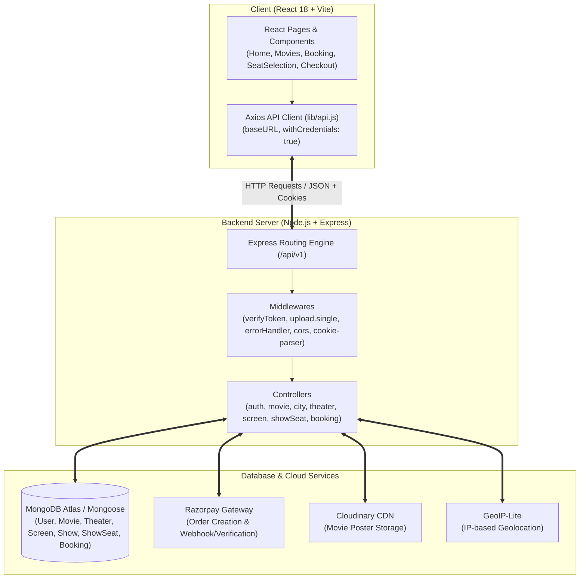

---

## 📊 Data Flow Diagrams (DFD)

A formal breakdown of inputs, processes, data transformations, data stores, and outputs across CineVerse.

### DFD Level 0: Context-Level Diagram

The Level 0 context diagram demonstrates the entire CineVerse system as a single central process interacting with external entities (Customer, Admin, Razorpay, Cloudinary, and GeoIP):

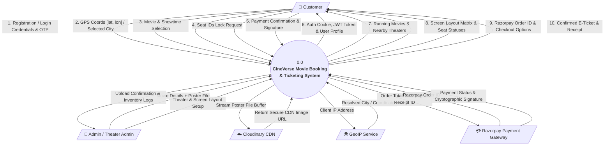

---

### DFD Level 1: System-Level Functional Diagram

Decomposes the system into 5 primary processes, with explicit incoming/outgoing data flows and reads/writes to MongoDB data stores:

```mermaid
flowchart TD
    %% Entities
    Customer[/"👤 Customer"/]
    Admin[/"👑 Admin"/]
    Razorpay[/"💳 Razorpay"/]
    Cloudinary[/"☁️ Cloudinary"/]

    %% Data Stores
    D1[("D1: Users Store")]
    D2[("D2: Movies Store")]
    D3[("D3: Theaters & Screens Store")]
    D4[("D4: Shows & ShowSeats Store")]
    D5[("D5: Bookings & Transactions Store")]

    %% Processes
    P1(("1.0<br/>Authentication &<br/>Identity Engine"))
    P2(("2.0<br/>Geospatial Search<br/>& Movie Catalog"))
    P3(("3.0<br/>Theater & Showtime<br/>Scheduling Engine"))
    P4(("4.0<br/>Screen Layout &<br/>Seat Lock Engine"))
    P5(("5.0<br/>Booking & Payment<br/>Processing Engine"))

    %% P1 Auth Flows
    Customer -->|"Email, Mobile, Password, OTP"| P1
    P1 -->|"Write New User / Update OTP & Expiry"| D1
    D1 -->|"Read Hash & 2FA Status"| P1
    P1 -->|"JWT Cookie & Session Data"| Customer

    %% P2 Movie Catalog Flows
    Admin -->|"New Movie Data + Poster Buffer"| P2
    P2 -->|"Upload Buffer"| Cloudinary
    Cloudinary -->|"Poster CDN URL"| P2
    P2 -->|"Save Movie Document"| D2
    Customer -->|"Coordinates [lat, lon] / City"| P2
    P2 -->|"$near 2dsphere Lookup"| D3
    D3 -->|"Nearby Theater IDs"| P2
    P2 -->|"Distinct Movie IDs"| D4
    D4 -->|"Active Movie IDs"| P2
    P2 -->|"Read Movie Profiles"| D2
    D2 -->|"Movie Details"| P2
    P2 -->|"Movie List & Metadata"| Customer

    %% P3 Show Scheduling Flows
    Customer -->|"Movie ID + Date + Coords"| P3
    P3 -->|"Fetch Shows by Date & Movie"| D4
    D4 -->|"Showtimes & Screen Names"| P3
    P3 -->|"Read Theater Info"| D3
    D3 -->|"Theater Names & Locations"| P3
    P3 -->|"Grouped Theaters & Showtime Slots"| Customer

    %% P4 Seat Layout & Concurrency Lock Flows
    Customer -->|"Show ID Request"| P4
    P4 -->|"Read Screen Rows & Layout"| D3
    P4 -->|"Read Seat Statuses (booked/locked)"| D4
    P4 -->|"Merged Seat Matrix (Available, Locked, Booked)"| Customer
    Customer -->|"Lock Seat IDs ['A1', 'A2'] + User ID"| P4
    P4 -->|"Check & Write Lock with 10-Min Expiry TTL"| D4
    P4 -->|"Seat Lock Acknowledgment"| Customer

    %% P5 Booking & Payment Flows
    Customer -->|"Order Payload (Show, Seats, Pricing)"| P5
    P5 -->|"Compute Fee (16%) & Create Order"| Razorpay
    Razorpay -->|"Razorpay Order ID"| P5
    P5 -->|"Save Pending Booking Document"| D5
    P5 -->|"Set ShowSeats Status = 'booked'"| D4
    P5 -->|"Razorpay Order Info & Key"| Customer
    Customer -->|"Payment ID + Signature + Order ID"| P5
    P5 -->|"HMAC-SHA256 Signature Validation"| P5
    P5 -->|"Fetch Payment Status"| Razorpay
    Razorpay -->|"Payment State: captured/authorized"| P5
    P5 -->|"Update Booking Status = 'confirmed'"| D5
    P5 -->|"Confirmed Ticket & QR Details"| Customer
```

---

### DFD Level 2: Core Booking & Payment Subsystem DFD

Deep dive into the critical checkout and payment verification transactions (Process 5.0):

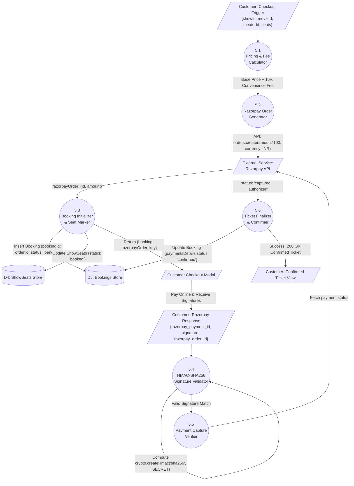

---

## 🚀 End-to-End User Booking Journey

This is how a typical user navigates through CineVerse, showing the chain of API calls at every stage:

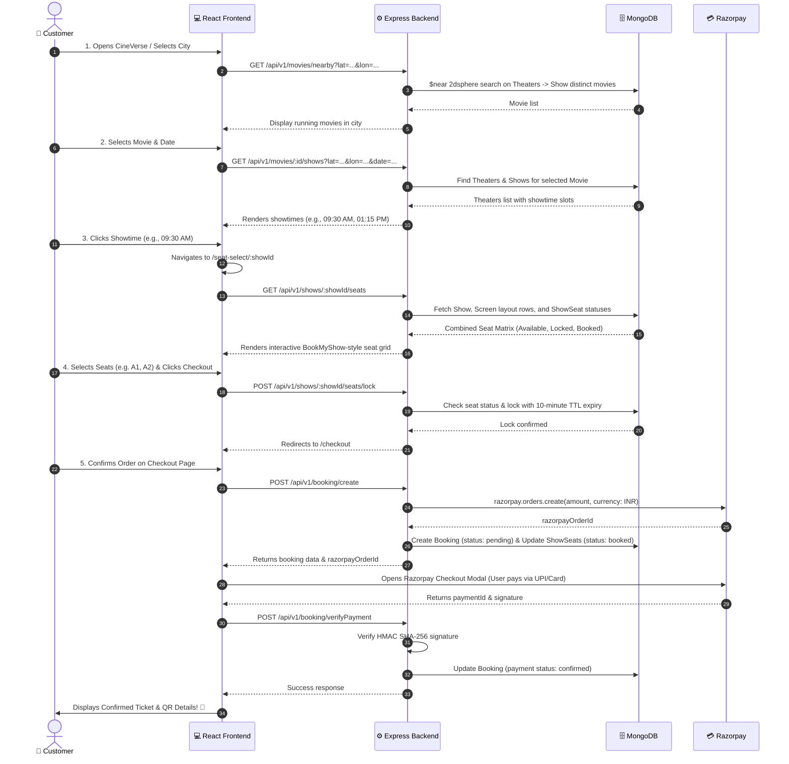

---

## 🔬 Deep-Dive Module Data Flows

### Flow 1: Authentication & 2FA Flow

Manages user registration, secure login with bcrypt password comparison, optional 2-Factor Authentication (OTP), and JWT token delivery via HTTP-only cookies.

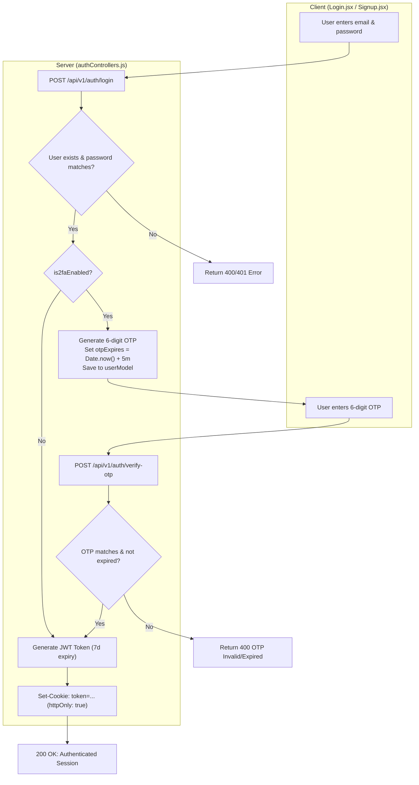

#### Related Endpoints:
- `POST /api/v1/auth/register` : Validates uniqueness, hashes password with `bcrypt.hash(password, 10)`, creates user document.
- `POST /api/v1/auth/login` : Authenticates credentials; issues JWT or triggers 2FA OTP.
- `POST /api/v1/auth/verify-otp` : Checks OTP and expiration; sets JWT in `httpOnly` cookie.
- `POST /api/v1/auth/resend-otp` : Rate-limited (minimum 2 minutes interval using `otpSentLastTime`).
- `POST /api/v1/auth/verify` : Validates incoming cookie using `verifyToken` middleware; returns user profile (`id`, `name`, `email`, `role`).

---

### Flow 2: Geolocation & Movie Discovery Flow

Allows users to find nearby theaters and currently running movies within a geographic radius (default: 30 km to 50 km).

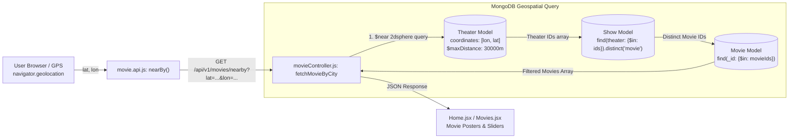

#### Key Technical Detail:
- Uses MongoDB `2dsphere` index on `Theater.location`.
- Coordinates must be in GeoJSON order: `[longitude, latitude]`.

---

### Flow 3: Shows & Theater Schedule Flow

When a user selects a movie, this flow retrieves all theaters in the user's city/radius currently screening the movie, categorized with dates and showtimes.

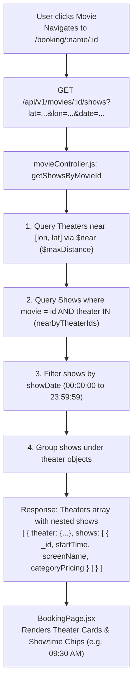

---

### Flow 4: Screen Layout & Real-time Seat Locking Flow

Renders the interactive seat map and prevents double-booking through temporary seat locking (10 minutes TTL).

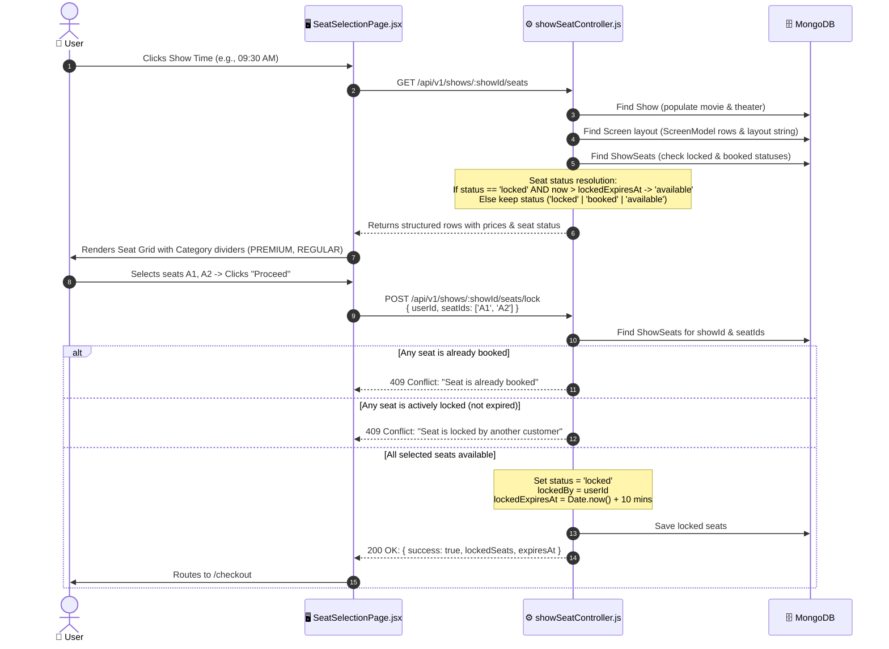

---

### Flow 5: Booking Creation & Razorpay Payment Verification Flow

Handles order placement, fee computation, Razorpay order generation, client payment modal, and server-side cryptographic signature validation.

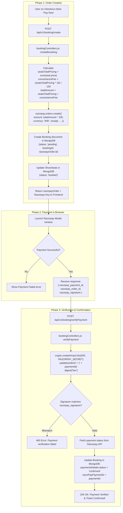

---

## 🗺️ Database Entity Relationship Map

Below is how the Mongoose models connect with each other:

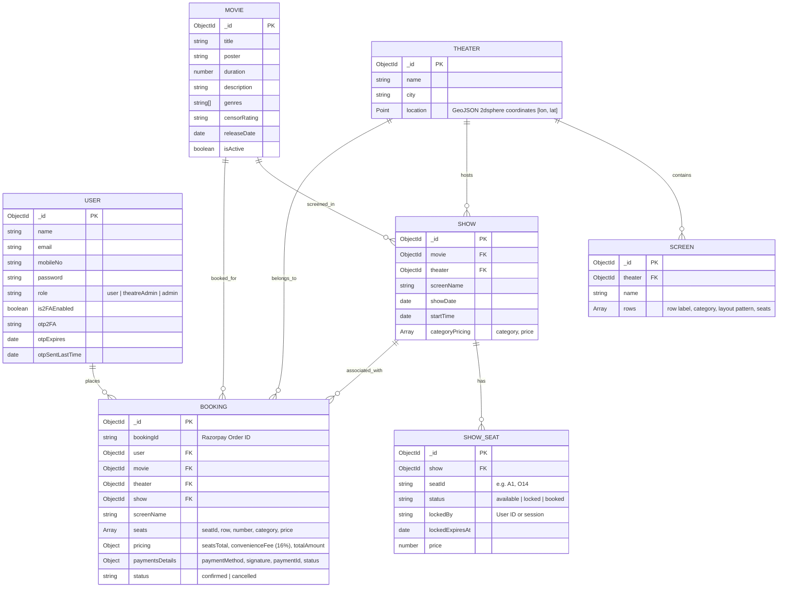

---

## 📋 Complete API Registry & Payload Reference

### 1. Authentication APIs (`/api/v1/auth`)

| Method | Endpoint | Description | Middleware | Request Body | Response Success |
|---|---|---|---|---|---|
| `POST` | `/api/v1/auth/register` | Register new user | None | `{ name, email, mobileNo, password }` | `201: { message: "user created" }` |
| `POST` | `/api/v1/auth/login` | Login user | None | `{ email, password }` | `200: { message: "success" }` (sets `token` cookie) or sends OTP |
| `POST` | `/api/v1/auth/verify-otp` | Verify 2FA OTP | None | `{ id, otp }` | `200: { message: "success" }` (sets `token` cookie) |
| `POST` | `/api/v1/auth/resend-otp` | Resend 2FA OTP | None | `{ email }` | `200: { message: "OTP SENT SUCCESSFULLY" }` |
| `POST` | `/api/v1/auth/2fa/enable` | Enable 2FA | None | `{ id, status: true }` | `200: { message: "Two factor authentication is enabled" }` |
| `POST` | `/api/v1/auth/2fa/disable` | Disable 2FA | None | `{ id, status: false }` | `200: { message: "Two factor authentication is disabled" }` |
| `POST` | `/api/v1/auth/verify` | Verify current session | `verifyToken` | Cookie: `token` | `200: { isAuthenticated: true, id, name, email, role }` |

---

### 2. Movies APIs (`/api/v1`)

| Method | Endpoint | Description | Params / Query / Body | Response Data |
|---|---|---|---|---|
| `GET` | `/api/v1/movies` | Get paginated movies | `?search=&page=1&limit=20` | `{ success: true, count, totalPages, data: [movies] }` |
| `POST` | `/api/v1/movies` | Create movie with poster upload | `multipart/form-data`: `poster` file, `title`, `duration`, `genres`, etc. | `201: { success: true, data: movie }` (Uploaded to Cloudinary) |
| `GET` | `/api/v1/movies/:id` | Get single movie details | `id` (Path param) | `{ success: true, data: movie }` |
| `GET` | `/api/v1/movies/nearby` | Get movies playing near location | `?lat=26.91&lon=75.78&radius=3000` | `{ data: [movies] }` |
| `GET` | `/api/v1/movies/now-playing` | Get grouped theaters & shows by location | `?lat=...&lon=...&radius=30000&date=...` | `{ success: true, data: { theaters: [...] } }` |
| `GET` | `/api/v1/movies/:id/shows` | Get showtimes for specific movie | `id` (param), `?lat=...&lon=...&date=...` | `{ success: true, data: [theatersWithShows] }` |

---

### 3. Cities & Theaters APIs (`/api/v1`)

| Method | Endpoint | Description | Params / Query | Response Data |
|---|---|---|---|---|
| `GET` | `/api/v1/cities` | List all available cities | `?s=search_term` | `{ success: true, count, data: [cities] }` |
| `GET` | `/api/v1/getLocation` | Get client location & cities | `?s=search_term` | `{ success: true, cities, geo }` |
| `GET` | `/api/v1/theaters` | List theaters by city or coordinates | `?city=Jaipur` OR `?lat=...&lon=...` | `{ success: true, count, data: [theaters] }` |
| `GET` | `/api/v1/screens/theater/:theaterId` | Get screen layout for a theater | `theaterId` (Path param) | `{ success: true, data: [screens] }` |

---

### 4. Shows & Seat Management APIs (`/api/v1/shows`)

| Method | Endpoint | Description | Request Body | Response Data |
|---|---|---|---|---|
| `GET` | `/api/v1/shows/:showId/seats` | Fetch interactive screen seat matrix | None | `{ success: true, data: { show, movie, theater, rows: [ { label, category, price, layout, seats: [ { seatId, status, rowPrice } ] } ] } }` |
| `POST` | `/api/v1/shows/:showId/seats/lock` | Temporarily lock seats before checkout | `{ userId, seatIds: ["A1", "A2"] }` | `{ success: true, lockedSeats: ["A1", "A2"], expiresAt: "..." }` |

---

### 5. Booking & Payment APIs (`/api/v1/booking`)

| Method | Endpoint | Description | Request Body | Response Data |
|---|---|---|---|---|
| `POST` | `/api/v1/booking/create` | Initialize order & create Razorpay order | `{ showId, movieId, theaterId, screenName, seats: [ { seatId, price } ] }` | `{ message: "success", booking: {...}, razorpayOrder: { id, amount, currency, key } }` |
| `POST` | `/api/v1/booking/verifyPayment` | Validate Razorpay HMAC signature | `{ paymentId, signature, razorPayOrderId }` | `{ success: true, message: "payment verified" }` |

---

## 🧮 Key Business Logic & Formulas

### 1. Booking Pricing Calculation
Calculated inside `server/controllers/bookingControllers.js`:
```javascript
// Base seats pricing
const seatsTotalPricing = seats.reduce((acc, s) => Number(s.price) + acc, 0);

// Convenience fee: 16% on tickets
const convenienceFee = (seatsTotalPricing * 16) / 100;

// Grand total payable
const totalAmount = seatsTotalPricing + convenienceFee;

// Razorpay takes amount in smallest currency unit (Paise for INR)
const razorpayAmount = totalAmount * 100;
```

### 2. Seat Locking Concurrency Control
Inside `server/controllers/showSeatController.js`:
- **Collision Prevention**: Checks if any seat in `seatIds` has `status === 'booked'` or (`status === 'locked'` AND `lockedExpiresAt > new Date()`). If yes, immediately responds with HTTP `409 Conflict`.
- **Lock Expiration TTL**: When locked, sets `lockedExpiresAt = new Date(Date.now() + 10 * 60 * 1000)` (10 minutes window).
- **Auto-release**: When fetching `/shows/:showId/seats`, any seat with expired lock is automatically treated as `'available'`.

### 3. Payment Signature Cryptographic Verification
Inside `server/controllers/bookingControllers.js`:
```javascript
const generatedSignature = crypto
  .createHmac('sha256', process.env.RAZORPAY_API_SECRET)
  .update(razorPayOrderId + '|' + paymentId)
  .digest('hex');

const isAuthentic = (generatedSignature === signature);
```

---

## 💡 Frontend Integration Quick Reference

All frontend API calls are centralized under `client/src/services/`:
- [auth.api.js](file:///d:/cineVerse/client/src/services/auth.api.js): `login()`, `register()`, `verifyOtp()`, `verify()`
- [movie.api.js](file:///d:/cineVerse/client/src/services/movie.api.js): `fetchMovies()`, `fetchMovieById()`, `nearBy()`, `getShowByMovieId()`, `getShowSeats()`, `fetchTheaters()`, `fetchCities()`
- [booking.api.js](file:///d:/cineVerse/client/src/services/booking.api.js): `createBooking()`, `verifyPayment()`
- [api.js](file:///d:/cineVerse/client/src/lib/api.js): Pre-configured Axios instance with `baseURL: import.meta.env.VITE_API_URL` and `withCredentials: true` (for automatic cookie forwarding).
